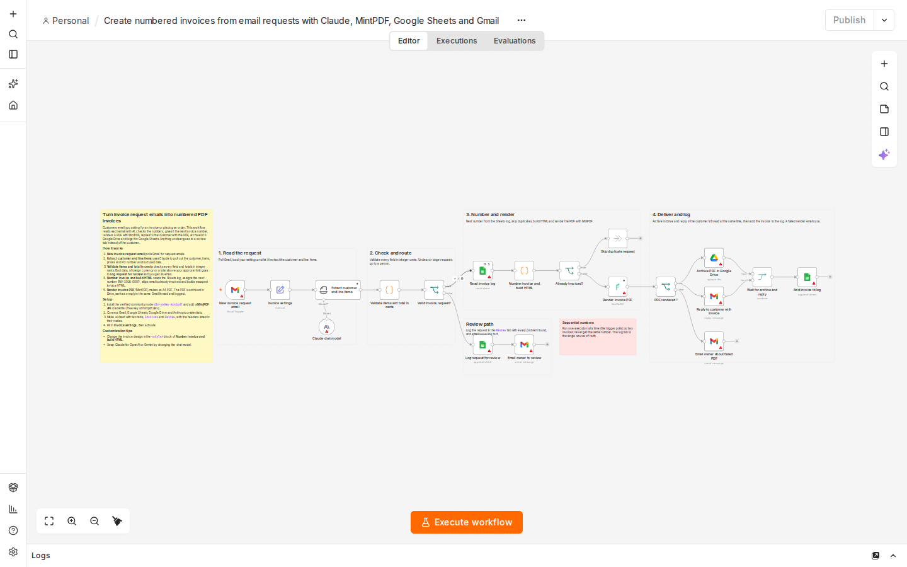
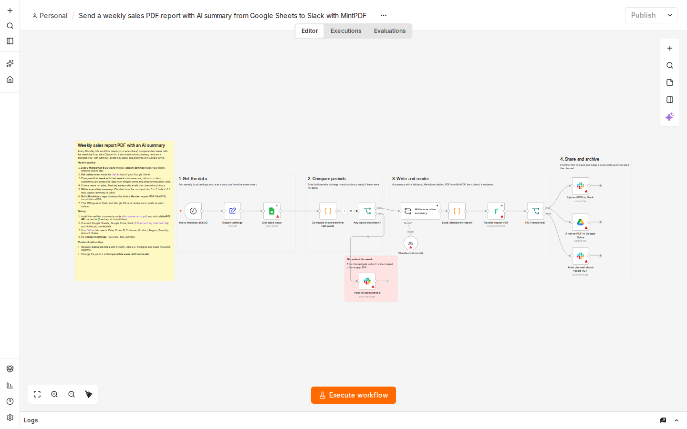
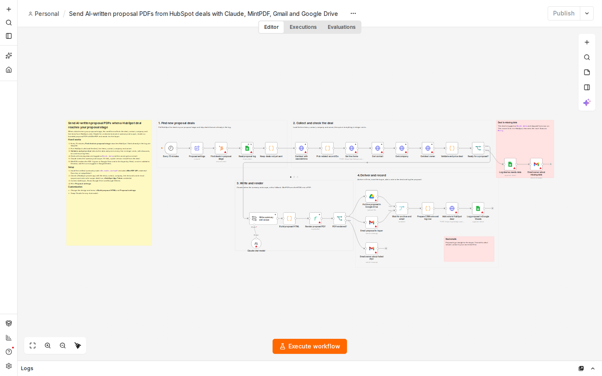

# n8n templates for n8n-nodes-mintpdf

Three templates for creators.n8n.io. Each one has a workflow JSON, a canvas screenshot (1440x900) and the text for the submission form below.

The JSON files have no credentials, no pinned data and no personal data. The MintPDF credential Base URL stays at the default `https://mintpdf.dev`. Sheet IDs, folder IDs, the Slack channel and the HubSpot stage ID are placeholders in the settings node.

`n8n-nodes-mintpdf` was approved as a verified community node on 2026-10-06. All descriptions say so. The old "self-hosted only" note is gone. Upload the matching PNG as the workflow image, because previews of community nodes do not always render.

---

## The bar we built to (why v1 was "too basic")

Sources: the official submission guidelines (n8n.notion.site, "Template submission guidelines" and "Sticky note guidelines for templates") and the popular invoice, PDF and report templates on n8n.io/workflows (for example 4452, 15791, 18284, 19015, 19127).

What the guidelines say:
- No low-effort templates. A template must show thoughtful design, real-world value, and fill a gap in the library.
- Title: "Action verb + thing + to/from/in where", main nodes in the title, sentence case, no hype.
- Description: Markdown, about 200 words, with the sections Who's it for, How it works, How to set up, Requirements, How to customize the workflow.
- One yellow overview sticky (100 to 300 words, with "How it works" and "Setup"), white section stickies for groups of nodes, optional red warning stickies.
- Every node renamed to say what it does. User settings in one Set node. No credentials, IDs or real emails.

What the published templates that get traction have (our v1 had none of this):
- 12 to 20 nodes with real branching (IF or Switch), not one straight line.
- A real data source and a real sink, with state: a Google Sheets log, sequential numbers, an archive in Drive.
- Input validation and an error path (bad data, a failed API call).
- An AI step where it adds value (extraction or a written summary).
- A real edge case handled on purpose (money rounding, duplicates, currencies, empty data).
- Form to invoice PDF already exists many times (19127 is almost our v1). The new invoice template starts from email with AI extraction, which the library does not have yet.

---

## 1. Invoices from email requests

- **File:** `generate-invoice-pdfs-from-a-form.json` (the name is kept from v1; the trigger is now Gmail)
- **Screenshot:** `generate-invoice-pdfs-from-a-form.png`
- **Title:** Create numbered invoices from email requests with Claude, MintPDF, Google Sheets and Gmail
- **Category:** Document Ops (add Finance / Invoice Processing and AI if the form offers them)
- **Nodes:** 19 plus 7 stickies. Gmail Trigger, Set, Information Extractor + Anthropic Chat Model, 2 Code, 3 IF, Google Sheets (read, 2 x append), MintPDF, Google Drive, Gmail (reply + 2 alerts), Merge, No Op.

### Description (paste as Markdown)

```markdown


> Uses the verified community node `n8n-nodes-mintpdf`.

## Who's it for
Freelancers, agencies and small B2B teams whose customers ask for invoices or place orders by email, and who still type each invoice by hand.

## How it works
1. **Gmail Trigger** picks up new order and invoice request emails.
2. **Claude** (Information Extractor) pulls out the customer, billing address, PO number and line items as structured data.
3. A **Code** node checks every field and does all money maths in integer cents. Missing prices, a foreign currency or a total above your approval limit go to a **Review** tab in Google Sheets, and you get an email.
4. The next invoice number (INV-2026-0001) comes from your **Google Sheets** log. Emails that were already invoiced are skipped.
5. **MintPDF** renders an A4 PDF from escaped HTML. If rendering fails, you get an email and nothing is sent.
6. The PDF is archived in **Google Drive**, sent as a **Gmail** reply in the customer's thread, and logged with its Drive link.

## How to set up
1. Install `n8n-nodes-mintpdf` and add a MintPDF API credential (free key at mintpdf.dev).
2. Connect Gmail, Google Sheets, Google Drive and Anthropic.
3. Make a sheet with an `Invoices` tab and a `Review` tab (headers are listed in the nodes).
4. Fill in **Invoice settings** and activate.

## Requirements
- A MintPDF API key (free plan: 100 PDFs a month)
- Gmail, Google Sheets and Google Drive
- An Anthropic API key (or swap in another chat model)

## How to customize the workflow
Change the invoice design in **Number invoice and build HTML**, set your tax rate and approval limit in **Invoice settings**, or replace Claude with OpenAI or Gemini.
```

---

## 2. Weekly sales report PDF

- **File:** `weekly-report-pdf-to-slack.json`
- **Screenshot:** `weekly-report-pdf-to-slack.png`
- **Title:** Send a weekly sales PDF report with AI summary from Google Sheets to Slack with MintPDF
- **Category:** Document Ops (add Reporting / Sales and AI if the form offers them)
- **Nodes:** 14 plus 6 stickies. Schedule Trigger, Set, Google Sheets, 2 Code, 2 IF, Basic LLM Chain + Anthropic Chat Model, MintPDF, Slack (upload + 2 messages), Google Drive.

### Description (paste as Markdown)

```markdown


> Uses the verified community node `n8n-nodes-mintpdf`.

## Who's it for
E-commerce, sales and ops teams that keep orders in Google Sheets and want a clear weekly report in Slack without building it by hand.

## How it works
1. A **Schedule Trigger** runs every Monday at 8:00.
2. **Google Sheets** returns every row of your `Sales` tab.
3. A **Code** node compares last week with the week before: gross and net revenue, refunds, orders, units, customers, new customers, average order value, top products, regions and revenue by day. Money is summed in integer cents. Rows with a bad date or amount are skipped and counted.
4. No sales? Slack gets a short notice instead of an empty PDF.
5. **Claude** writes a 3 to 5 bullet executive summary from the numbers only. If the AI call fails, a plain summary is used, so the report still goes out.
6. **MintPDF** renders the Markdown tables to a PDF with page numbers.
7. The PDF is posted to **Slack** and archived in **Google Drive**. A render error posts an alert instead.

## How to set up
1. Install `n8n-nodes-mintpdf` and add a MintPDF API credential (free key at mintpdf.dev).
2. Connect Google Sheets, Google Drive, Slack and Anthropic.
3. Give your `Sales` tab the columns Date, Order ID, Customer, Product, Region, Quantity, Amount, Status.
4. Fill in **Report settings**, run once, then activate.

## Requirements
- A MintPDF API key (free plan: 100 PDFs a month)
- Google Sheets, Google Drive and a Slack bot with `files:write` and `chat:write`
- An Anthropic API key (or another chat model)

## How to customize the workflow
Replace **Get sales rows** with Shopify, Stripe or Postgres and keep the same columns. Change the period in **Compare this week with last week**, or send the PDF by Gmail instead of Slack.
```

---

## How these were tested (2026-10-09)

Local n8n 2.42.6 with `n8n-nodes-mintpdf@0.1.0` from npm, and a local MintPDF server. Nodes that need third-party credentials (Gmail, Sheets, Drive, Slack, Claude) were simulated: data sources and AI nodes had pinned data, and sink nodes were swapped for Set nodes with the same expressions so every expression was evaluated. Everything else ran for real, including every MintPDF render. Paths tested: valid invoices, missing price, foreign currency plus approval limit, duplicate email, empty log (numbering starts at 0001), MintPDF down; report with AI summary, AI failure fallback, no sales week, MintPDF down. PDFs were checked as images, and the report totals were checked against an independent Python calculation.

Note: MintPDF node 0.1.0 does not route failed items to n8n's "error output" (its error item has a `description` key, and n8n only accepts `error`, `message` and `details`). The templates use "Continue" plus a **PDF rendered?** IF instead, which works with every version. The node source has a one-line fix (`description` renamed to `details`, not yet released).

---

## 3. Proposal PDFs from HubSpot deals

- **File:** `hubspot-deal-proposal-pdf.json`
- **Screenshot:** `hubspot-deal-proposal-pdf.png`
- **Sample PDF (2 pages, rendered by the workflow in the local test):** `hubspot-deal-proposal-pdf-sample.png`
- **Title:** Send AI-written proposal PDFs from HubSpot deals with Claude, MintPDF, Gmail and Google Drive
- **Category:** Sales (add Document Ops and AI if the form offers them)
- **Nodes:** 27 plus 7 stickies. Schedule Trigger, Set, HubSpot (deal search), 5 HTTP Request with the HubSpot credential (deal, line items, contact, company, owner) plus 1 for the deal note, 4 Code, 2 IF, Basic LLM Chain + Anthropic Chat Model, MintPDF, Google Drive, Gmail (buyer + 2 alerts), Merge, Google Sheets (read + 2 x append).

Why this one: the library has 273 HubSpot templates and only 52 Pipedrive templates (n8n template search, 2026-10-17). No template turns a HubSpot deal into a proposal PDF. The closest are a Pipedrive quote that needs a self-hosted Gotenberg (10243) and AI proposal templates that start from a form, a brief or Google Docs, not a HubSpot deal (14312, 16170, 21000).

### Description (paste as Markdown)

```markdown


> Uses the verified community node `n8n-nodes-mintpdf`.

## Who is it for
B2B sales teams, agencies and consultancies that keep deals in HubSpot and still build every proposal by hand in a doc or slide deck.

## What it does
1. Every 15 minutes, **HubSpot** returns the deals in your proposal stage. Deals already in your **Google Sheets** log are skipped.
2. HubSpot API calls load each deal with its line items, contact, company and owner.
3. A **Code** node checks the data and prices every line in integer cents: discounts, quantity, tax, and one-time and recurring fees in separate totals.
4. A deal with no contact, no email, no line items or a missing price is logged as `Needs data` and the deal owner gets an email.
5. **Claude** writes an executive summary and scope from the deal notes. If the AI call fails or returns prices, a plain summary built from the deal is used instead.
6. **MintPDF** renders a branded A4 proposal from escaped HTML, with page numbers and a footer. If rendering fails, the owner gets an email and the deal is tried again on the next run.
7. The PDF is saved in **Google Drive**, emailed to the buyer with **Gmail**, a note is added to the HubSpot deal, and the proposal is logged.

## How to set up
1. Install `n8n-nodes-mintpdf` and add a MintPDF API credential (free key at mintpdf.dev).
2. Create a HubSpot private app with read scopes for deals, contacts, companies, line items and owners, and write scope for notes. Add it as a HubSpot App Token credential.
3. Connect Anthropic, Gmail, Google Drive and Google Sheets.
4. Make a `Proposals` tab with the headers listed in **Log proposal in Google Sheets**.
5. Fill in **Proposal settings** (stage ID, company, tax, terms, IDs), test with a deal that has your own email, then activate.

## Requirements
- A MintPDF API key (free plan: 100 PDFs a month)
- HubSpot with a private app token
- An Anthropic API key (or another chat model)
- Gmail, Google Drive and Google Sheets

## How to customize
Change the design, colours and sections in **Build proposal HTML**. Set terms, tax and validity in **Proposal settings**. Switch the Gmail node to "Create draft" if reps should review before sending, or move the deal to the next stage after the note.
```

### Requirements, one line each (for the form)

- A MintPDF API key (free plan: 100 PDFs a month)
- HubSpot with a private app token (deals, contacts, companies, line items, owners read; notes write)
- An Anthropic API key (or another chat model)
- Gmail, Google Drive and Google Sheets

### Customization, one line each (for the form)

- Change the proposal design, colours and sections in **Build proposal HTML**.
- Set tax rate, validity days, terms and brand colour in **Proposal settings**.
- Switch **Email proposal to buyer** to "Create draft" so a rep reviews before sending.
- Add a HubSpot node after the note to move the deal to your "Proposal sent" stage.
- Replace Claude with OpenAI or Gemini by swapping the chat model.

### How template 3 was tested (2026-10-17)

Local n8n 2.42.6 with `n8n-nodes-mintpdf@0.1.1` from npm and a local MintPDF server (never production). The HubSpot HTTP Request nodes ran for real against a local fake HubSpot v3 API, so their URLs and JSON bodies were evaluated. The HubSpot search, the log read and the Claude chain were Code stand-ins with fixed data. Gmail, Drive and Sheets append were Set nodes with the same expressions. Every MintPDF render was real.

Paths tested: a full deal with discounts, decimal prices, monthly and yearly fees and 8.25% tax (totals checked against an independent Python Decimal calculation); a deal with no contact and a line item without a price (flagged, owner emailed); a deal already `Sent` (skipped); a `Retry` row (processed again); everything already handled (stops early); AI error and AI text that quotes a price (both use the fallback); deal owner not found (falls back to the settings email); company missing (contact name used); MintPDF down (owner alert, nothing sent or logged). HTML escaping was checked with `<Traders> & Sons`, a `<script>` tag in the deal notes and `<b>` in the AI text: all printed as plain text. PDFs were checked as images.

Not tested: the real HubSpot search node and live HubSpot, Anthropic, Gmail, Drive and Sheets APIs (no credentials). The HubSpot v3 response shapes (including the `line items` association key) follow HubSpot's docs.
